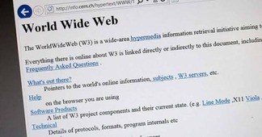

# 00)**Introduction To Web Page:

00.1)**The Frist Web Page Is Created By The English Web Scientist , Named By Tim Berners Lee In Aguest At 1991...

00.2)**The Frist Web Page Called World Wide Web (WWW)...

00.3)**The Frist Web Page Is A Non Graphical Web Page , Because Tim Berners Lee Only Uses HTML Language To Build The Structure Of Your Page Without Using Any Styling Language , Or Decoration Language Like CSS Language To Make The Styling , Or Decoration Of The Page...

00.4)**The Second Web Page Is Created By A Group Of Students In The Graduation Project In The College In 1993...

00.5)**The Second Web Page Is A Frist Graphical Web Page , Because This Group Of Students In The Graduation Project Use HTML Language To Build The Structure Of Your Own Web Page , And Also Using CSS Language To Make Styling , And Decorations Of Your Own Web Page...

