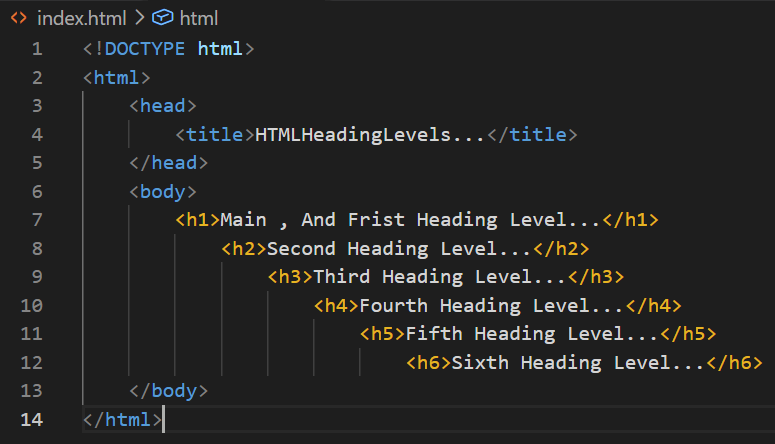
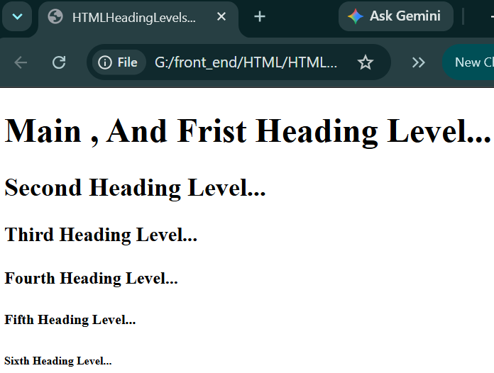
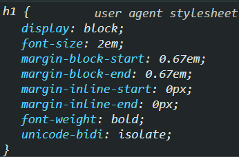
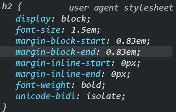
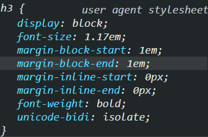
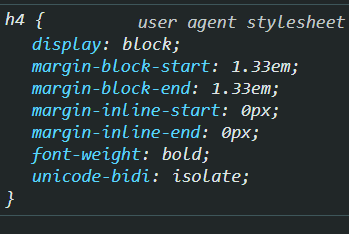
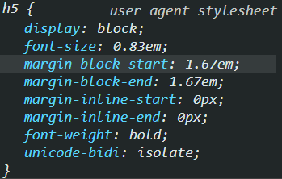
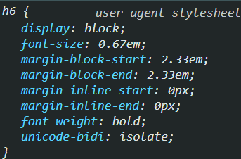

# 10)**Different HTML Heading Levels:

### 10.1)**There Are Different HTML Heading Levels From &lt;H1&gt; To &lt;H6gt; Like:

  - 10.1.1)**&lt;H1&gt;: It Is A Nested HTML Tag , It Is The Frist , And Main HTML Heading Between Different Heading Levels...&lt;/H1&gt;
  - 10.1.2)**&lt;H2&gt;: It Is A Nested HTML Tag , It Is The Second HTML Heading...&lt;/H2&gt;
  - 10.1.3)**&lt;H3&gt;: It Is A Nested HTML Tag , It Is The Third HTML Heading...&lt;/H3&gt;
  - 10.1.4)**&lt;H4&gt;: It Is A Nested HTML Tag , It Is The Fourth HTML Heading...&lt;/H4&gt;
  - 10.1.5)**&lt;H5&gt;: It Is A Nested HTML Tag , It Is The Fifth HTML Heading...&lt;/H5&gt;
  - 10.1.6)**&lt;H6&gt;: It Is A Nested HTML Tag , It Is The Sixth HTML Heading...&lt;/H6&gt;

<table>
  <tr>
    <td colspan="2">
      
    </td>
  </tr>  
  <tr>
    <td>
      
    </td>
    <td>
      
    </td>
  </tr>  
</table>

-----------------------------------------------------------------------------------------

10.2)**When Using Different Heading Levels You Must Follow Hierarichal Ordering Between Different Heading Levels Like Using &lt;H1&gt; For The Frist , and Main Heading Level In Your Own HTML Document (Own Web Page) , &lt;H2&gt; For The Second Heading Level In Your Own HTML Document (Own Web Page) , And More To Make Your Own HTML Document (Own Web Page) SEO Friendly...

------------------------------------------------------------------------------------------

10.3)**By Coding , You Can Use &lt;H1&gt; More Than One Use In The Same Own HTML Document (Same Own Web Page) , But It Is Not Logical , Because It Is Not Logic To Make A Title Of Your Book More Than One Use In The Same Book... To Make Your Own HTML Document (Own Web Page) SEO Friendly...

-------------------------------------------------------------------------------------------

10.4)**You Can Use Any Heading From &lt;H2&gt; To &lt;H6&gt; More Than One Use In The Same Own HTML Document (Same Own Web Page)...

--------------------------------------------------------------------------------------------

10.5)**Different HTML Heading Levels From The HTML Language Has A CSS Custom Styling , Or CSS Custom Decoration From The UA Stylesheet (User Agent Stylesheet) From Different Browsers Like Google Chrome , Firefox Developer Edition , Or ETC...

<table align="center">
  <tr>
    <td>
      
    </td>
    <td>
      
    </td>
    <td>
      
    </td>
  </tr>
    <tr>
    <td>
      
    </td>
    <td>
      
    </td>
    <td>
      
    </td>
  </tr>
</table>
---------------------------------------------------------------------------------------------

10.6)**

