# 11)**Different HTML Formatting Elements:

11.1)**If You Want To Make A Formatted Text In Your Own HTML Document (Own Web Page) Without Using CSS Styling Language , Or CSS Decoration Language By Using Different HTML Formatted Tags From The HTML Language Like:

-------------------------------------------------------------------------------------------------------------------

  - 
11.1.1)**&lt;B&gt;: , It Is A Nested HTML Tag , It Refers To A Bold Text Without Any Importance Text...&lt;/B&gt;

  
  - 
11.1.2)**&lt;STRONG&gt;: It Is A Nested HTML Tag , It Refers To A Strong Bold Text With Importance Text...&lt;/STRONG&gt;

> [!Important]
> 
**The Main Difference Between &lt;B&gt; , And &lt;STRONG&gt; Is &lt;B&gt; Is Only Used For A Bold Text Without Any Importance , And &lt;STRONG&gt; Is Only Used For A Bold Text With Importance , For Example , If You Want To Buy A Air Condition From Amazon Egypt , And You Find The Product Name Is A Bold Text , Then You Must Use &lt;B&gt; HTML Tag , Because It Is Not Importance Text , If You Want To Get A Book From Online British Book Store , And You Find A Notice That You Must Not Buy This Book , Because This Book Is Not Exporting To Egypt , This Notice Should Put Inside &lt;STRONG&gt; , Because It Is Important Text...

      
  - 
11.1.3)**&lt;I&gt;: It Is A Nested HTML Tag , It Refers To An Italic Text Without Any Importance Text...&lt;/I&gt;

  
  - 
11.1.4)**&lt;EM&gt;: It Is A Nested HTML Tag , It Refers To An Emphasiszed Text With Importance Text...&lt;/EM&gt;
  
> [!Important]
> 
**The Main Difference Between &lt;I&gt; , And &lt;EM&gt; Is &lt;I&gt; Is Only Used For An Italic Text Without Any Importance , And &lt;EM&gt; Is Only Used For An Emphasised Text With Importance , For Example , If You Want To Buy A Air Condition From Amazon Egypt , And You Find The Product Name Is A Italic Text , Then You Must Use &lt;I&gt; HTML Tag , Because It Is Not Importance Text , If You Want To Get A Book From Online British Book Store , And You Find A Notice That You Must Not Buy This Book , Because This Book Is Not Exporting To Egypt , This Notice Should Put Inside &lt;EM&gt; , Because It Is Important Text...

  - 
11.1.5)**&lt;MARK&gt;: It Is A Nested HTML Tag , It Refers To A Marked Text , Or Highlighted Text...&lt;/MARK&gt;

  
> [!Tip]
> 
It Is Mainly Appearing When Searching For Any Content From Any Website Like Amazon Egypt In Different Browsers Like Google Chrome , Firefox Developer Edition...

  
  - 
11.1.6)**&lt;U&gt;: It Is A Nested HTML Tag , It Refers To An Underlined Text...

> [!Warning]
> 
**Now , You Must Know That It Is Not Recommended To Use &lt;U&gt; From Different HTML Formatting Elements In Your Own HTML Document (Own Web Page) , Because Any Underline Texts Refers To A Link In Your Own HTML Document (Own Web Page)...

  - 
11.1.7)**&lt;SMALL&gt;: It Is A Nested HTML Tag , It Refers To A Small Text...

> [!Tip]
> 
**The Main Purpose Of Using &lt;SMALL&gt; HTML Tag From Different Formatting Elements From The HTML Language In Your Own HTML Document , It Is Mainly Used To Make A SMALL Text Then Other Text In The Content , Because This Small Text Is Not Important Now , And Then Updated By A New Text To Make Your Own HTML Document (Own Web Page) SEO Friendly...

  - 
11.1.8)**&lt;INS&gt;: It Is A Nested HTML Tag , It Is Mainly Used To Make An Inserted Text...&lt;INS&gt;

> [!Important]
> 
**The Main Purpose Of Using &lt;INS&gt; Is Mainly Used To Add A New Inserted Text In Your Own HTML Document (Own Web Page) , And Know Different Browsers Like Google Chrome , Firefox Developer Edition , Or ETC That It Is An Inserted Text To Make Your Own HTML Document (Own Web Page) SEO Friendly...

  - 
11.1.9)**&lt;DEL&gt;: It Is A Nested HTML Tag , It Is Mainly Used To Make A Deleted Text...&lt;/DEL&gt;

> [!Important]
> 
**The Main Purpose Of Using &lt;DEL&gt; Is Mainly Used To Delete Text From Your Own HTML Document (Own Web Page) , And Know Different Browsers Like Google Chrome , Firefox Developer Edition , Or ETC That It Is A Deleted Text To Make Your Own HTML Document (Own Web Page) SEO Friendly...

> [!Tip]
> 
**For Example Of Using &lt;INS&gt; , And &lt;DEL&gt; , If You Want To Make A Sale For Some Products In Your Website Then You Must Put The Price Before The Sale For Some Products Inside &lt;DEL&gt; , And Put The Price After The Sale For Some Products Inside &lt;INS&gt;...

  - 
11.1.10)**&lt;SUP&gt;: It Is A Nested HTML Tag , It Refers To The Super Script...&lt;/SUP&gt;

> [!Tip]
> 
**It Is Mainly Used To Make A Super Scripts Texts Like Mathematics Operations (XY)... 

  - 
11.1.11)**&lt;SUB&gt;: It Is A Nested HTML Tag , It Refers To A Subscript Text...&lt;/SUB&gt;

-----------------------------------------------------------------------------------------------------------

**11.2)**Different HTML Formatting Elements From The HTML Language Has A CSS Custom Styling , Or CSS Custom Decorations From The User Agent Stylesheet (UA Stylesheet) From Different Browsers Like Google Chrome , Firefox Developer Edition , Or ETC Like:

  - 11.2.1)**&lt;B&gt;: It Displays Inline , And The Font-Weight Is Bolder...&lt;/B&gt;

    <table>
        <tr>
          <td>
            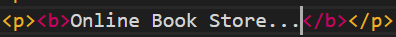
          </td>
          <td>
            
          </td>
          <td>
            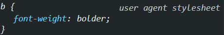
          </td>
        </tr>      
    </table>
  - 11.2.2)**&lt;STRONG&gt;: It Displays Inline , And The Font-Weight Is Bolder...&lt;/STRONG&gt;

<table>
  <tr>
    <td>
      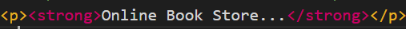
    </td>
    <td>
      
    </td>
    <td>
      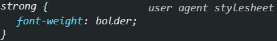
    </td>
  </tr>
</table>

  - 11.2.3)**&lt;I&gt;: It Displays Inline , And The Font-Style Is Italic...&lt;/I&gt;
<table>
  <tr>
    <td>
      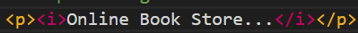
    </td>
    <td>
      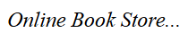
    </td>
    <td>
      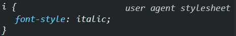
    </td>
  </tr>
</table>

  - 11.2.4)**&lt;EM&gt;: It Displays Inline , And The The Font-Style Is Italic...&lt;/EM&gt;

<table>
  <tr>
    <td>
      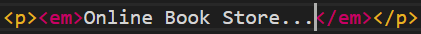
    </td>
    <td>
      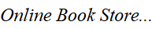
    </td>
    <td>
      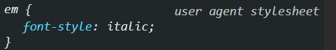
    </td>
  </tr>
</table>

  - 11.2.5)**&lt;MARK&gt;: It Displays Inline , Background-Color Is Mark , And The Color Is Mark...

<table>
  <tr>
    <td>
      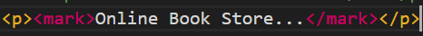
    </td>
    <td>
      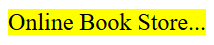
    </td>
    <td>
      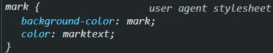
    </td>
  </tr>
</table>

  - 11.2.6)**&lt;U&gt;: It Displays Inline , And The Text-Decoration Is Inline...&lt;/U&gt;

<table>
  <tr>
    <td>
      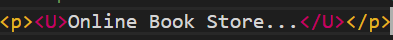
    </td>
    <td>
      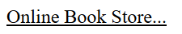
    </td>
    <td>
      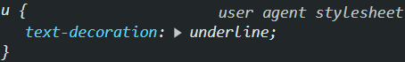
    </td>
  </tr>
</table>
