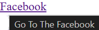
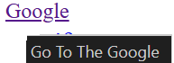
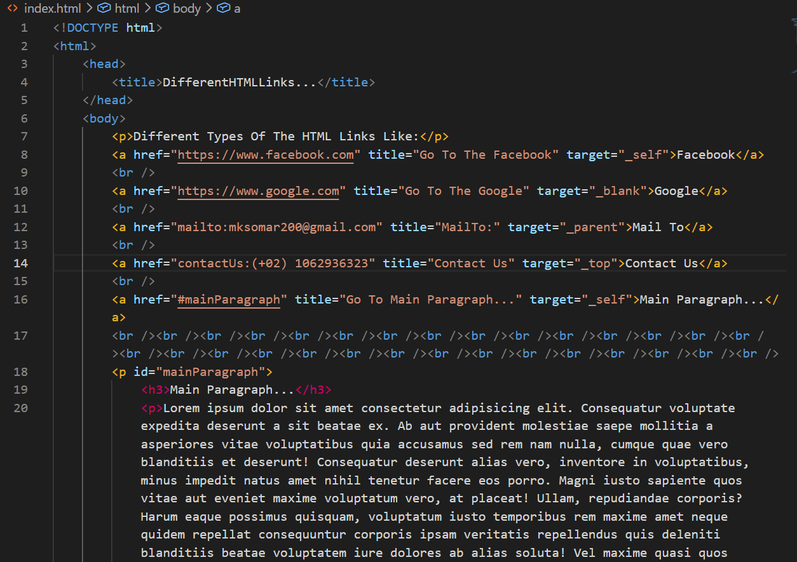
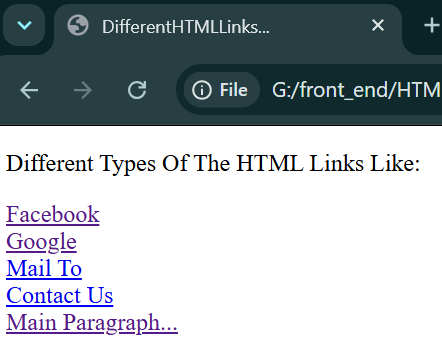
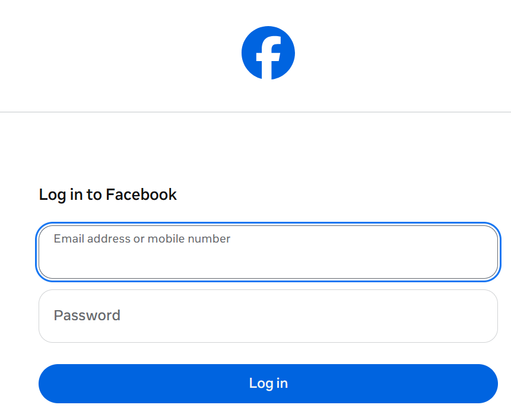
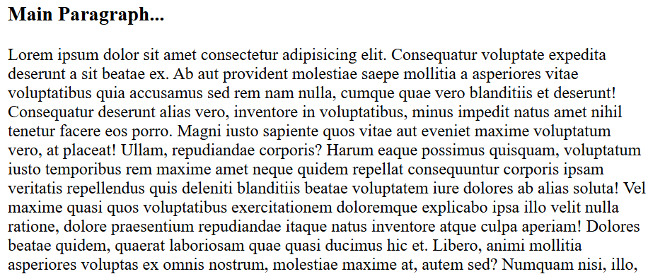

# 12)**Links In HTML Language:

12.1)**If You Want To Make A Link In Your Own HTML Document (Own Web Page) , Then You Must Use &lt;A&gt; From The HTML Language To Make An ANCHOR Tag...

--------------------------------------------------------------------------

12.2)**&lt;A&gt;: It Is A Nested HTML Tag , It Refers To ANCHOR Tag In Your Own HTML Document (Own Web Page) , It Is Mainly Used To Make An ANCHOR Tag In Your Own HTML Document (Own Web Page)...&lt;/A&gt;

-------------------------------------------------------------------------

12.3)**There Are Some Different HTML Attributes Should Use Inside &lt;A&gt; HTML Tag Like:

  - 
12.3.1)**HREF: It Refers To The Hyper Text Reference , It Is Element HTML Attribute , It Is Mainly Used Add The Full Path Of The Link In Your Own HTML Document (Own Web Page)... Like &lt;A HREF=&quot;The Full Path Of The Link Like (Facebook(&quot;https://www.facebook.com&quot;))Facebook&quot;&gt;&lt;/A&gt;

  - 
12.3.2)**TITLE: It Is An Element HTML Attribute , It Is Mainly Used As A Tool Tip To Know Different Users Of Your Own HTML Document (Own Web Page) , The Main Purpose Of Using This Link In Your Own HTML Document (Own Web Page)... Like &lt;A TITLE=&quot;It Is Used As A Tool Tip To Know To The Website That Go To Like (Go To Facebook)&quot;&gt;&lt;/A&gt;...

    <table>
      <tr>
        <td><strong>**&lt;A title="Go To Facebook"&gt;: </strong></td>
        <td></</td>
      </tr>
    </table>

    <table>
     <tr>
          <td><strong>**&lt;A title="Go To Google"&gt;</td>
      <td>
        
      </td>
     </tr>
    </table>

    <table>
    <tr>
            <td><strong>&lt;A title="Go To Mail"&gt;</strong></td>
      <td>
        
      </td>
    </tr>
    </table>

    <table>
      <tr>
        <td><strong>&lt;A title="Go To Contact Us"&gt;</strong></td>
      <td>
        
      </td>
      </tr>
    </table>

    <table>
      <tr>
        <td><strong>&lt;A title="Go To Main Paragraph"&gt;</strong></td>
        <td>
          
        </td>
      </tr>
    </table>
  - 
12.3.3)**TARGET: It Is An Element HTML Attribute , It Is Mainly Used To Specify Where The Link Document , Wen Page Should Be Opened When The User Clicks The Hyper Link... Like &lt;A TARGET="" &gt;&lt;/A&gt;

    - 
12.3.3.1)**There Are Different Values Of The Target HTML Attribute Like:

        - 
12.3.3.1.1)**&lt;A TARGET="_SELF" &gt;&lt;/A&gt;: It Is Mainly Used To Open The Link In The Same Browser Context (Defulat Tab)...</strong> 
      
        - 
12.3.3.1.2)**&lt;A TARGET="_BLANK" &gt;&lt;/A&gt;: It Is Mainly Used To Open The Link In A New Browsers Context (A New Browser Tab)...

        
        - 
12.3.3.1.3)**&lt;A TARGET="_PARENT" &gt;&lt;/A&gt;: It Is Mainly Used To Open The Link In The Parent Window...

        
        - 
12.3.3.1.4)**&lt;A TARGET="_TOP" &gt;&lt;/A&gt;: It Is Mainly Used To Open The Link In The Full Browsers Window...

      
----------------------------------------------------------------------------------------------------

<strong>12.4)**There Are Different Ways Of The Link In Your Own HTML Document Own Web Page Like:</strong>

- 
12.4.1)**&lt;A href=&quot;https://www.facebook.com&quot; title=&quot;Go To Facebook&quot; target=&quot;_SELF&quot;&gt;Facebook&lt;/A&gt; , This Link Opens In The Same Browser Context (Default)...

- 
12.4.2)**&lt;A href=&quot;https://www.google.com&quot; title=&quot;Go To Google&quot; target=&quot;_BLANK&quot;&gt;Google&lt;/A&gt; , This Link Opens In A New Browser Context (New Tab)...

- 
12.4.3)**&lt;A href=&quot;mailto:mksomar200@gmail.com&quot; title=&quot;Mail Me&quot; target=&quot;_TOP&quot;Mail Me&lt;/A&gt; , This Link Opens In The Top Browser Window...

- 
12.4.4)**&lt;A href=&quot;contactus:(+02) 1062936326&quot; title=&quot;Contact Me&quot; target=&quot;_PARENT&quot;&gt;Contact Me&lt;/A&gt; , This Link Opens In The Parent Window...

- 
12.4.5)**&lt;A href=&quot;#mainParagraph&quot; title=&quot;Go To The Main Paragraph&quot; target=&quot;_blank&quot;&gt;Main Paragraph&lt;/A&gt;

-----------------------------------------------------------------------------------------------------------

<table align="center">
  <tr>
    <td>
      
    </td>
  </tr>
  <tr>
    <td>
      
    </td>
  </tr>
</table>

---------------------------------------------------------------------------------------------------------------

<table align="center" width="650">
  <tr>
    <td align="center">
      <strong align="center">Result Of Clicking Facebook Link...</strong>
      
    </td>
  </tr>
  <tr>
    <td align="center">
      <strong align="center">Result Of Clicking Google Link...</strong>
      
    </td>
  </tr>
  <tr>
    <td align="center">
      <strong>Result Of Clicking Main Paragraph Link...</strong>
         
    </td>
  </tr>
</table>
