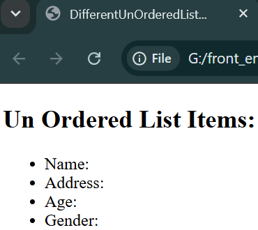

# 14)**Different HTML Lists:

### 14.1)**There Are Different HTML Lists From The HTML Language Like:

  - 
14.1.1)**&lt;UL&gt;: It Is A Nested HTML Tag , It Is Mainly Used To Make An UnOrdered List Of Different Items In Your Own HTML Document (Own Web Page)...&lt;/UL&gt;

    
    - 
14.1.1.1)**&lt;LI&gt;: It Is A Nested HTML Tag , It Is Mainly Used To Make A List Item In The UnOrdered List Of Different Items In Your Own HTML Document (Own Web Page)...&lt;/LI&gt;
    
    
    - 
<strong>14.1.1.2)**There Are Different Attributes , You Should Use Inside &lt;UL&gt; HTML Tag Like:</strong>

    
      - 
14.1.1.2.1)**TYPE HTML Attribute: It Is One Of Many HTML Elements Attributes That Mainly Used To Determine The Type Of The Ordering Of Different Items In The UnOrdered List , And <strong> There Are Different Types Like:</strong>

      
        - 
14.1.1.2.1.1)**type="disc": Then The Type Of The Ordering Is Filled Circle... , It Is The Default Type Of The UnOrdering List Of Different Items....

        <table align="center">
          <tr>
            <td>
              
            </td>
            <td>
              
            </td>
            <td>
              
            </td>
          </tr>
        </table>
        
        - 
14.1.1.2.1.2)**type="circle": Then The Type Of The Ordering Is Empty Circle...

        <table align="center"></table>
        
        - 
14.1.1.2.1.3)**type="square": Then The Type Of The Ordering Is Square...

        - 
14.1.1.2.1.4)**type="none": Then The Type Of The Ordering Is None...

  - 
14.1.2)**&lt;OL&gt;: It Is A Nested HTML Tag , It Is Mainly Used To Make An Ordered List Of Different Items In Your Own HTML Document (Own Web Page)...&lt;/OL&gt;

  
