# 14)**Different HTML Lists:

### 14.1)**There Are Different HTML Lists From The HTML Language Like:

  - 
14.1.1)**&lt;UL&gt;: It Is A Nested HTML Tag , It Is Mainly Used To Make An UnOrdered List Of Different Items In Your Own HTML Document (Own Web Page)...&lt;/UL&gt;

    
    - 
14.1.1.1)**&lt;LI&gt;: It Is A Nested HTML Tag , It Is Mainly Used To Make A List Item In The UnOrdered List Of Different Items In Your Own HTML Document (Own Web Page)...&lt;/LI&gt;
    
    
    - 
<strong>14.1.1.2)**There Are Different Attributes , You Should Use Inside &lt;UL&gt; HTML Tag Like:</strong>

    
      - 
14.1.1.2.1)**TYPE HTML Attribute: It Is One Of Many HTML Elements Attributes That Mainly Used To Determine The Type Of The Ordering Of Different Items In The UnOrdered List , And <strong> There Are Different Types Like:</strong>

      
        - 
14.1.1.2.1.1)**type="disc": Then The Type Of The Ordering Is Filled Circle... , It Is The Default Type Of The UnOrdering List Of Different Items....

        <table align="center">
          <tr>
            <td>
              
            </td>
            <td>
              
            </td>
            <td>
              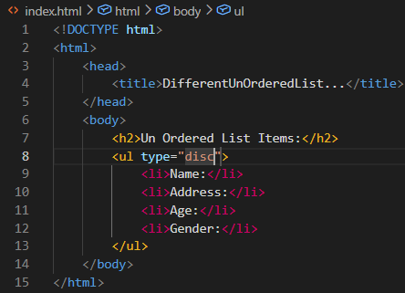
            </td>
          </tr>
        </table>
        
        - 
14.1.1.2.1.2)**type="circle": Then The Type Of The Ordering Is Empty Circle...

        <table align="center">
          <td>
            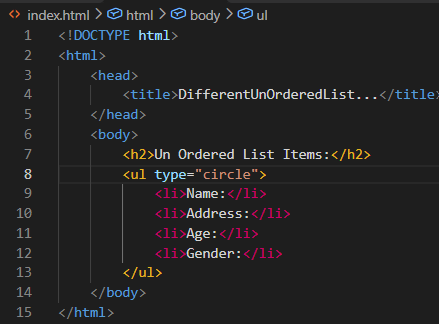
          </td>
          <td>
            
          </td>
        </table>
        
        - 
14.1.1.2.1.3)**type="square": Then The Type Of The Ordering Is Square...

        <table align="center">
          <tr>
            <td>
              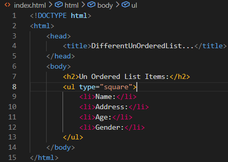
            </td>
            <td>
              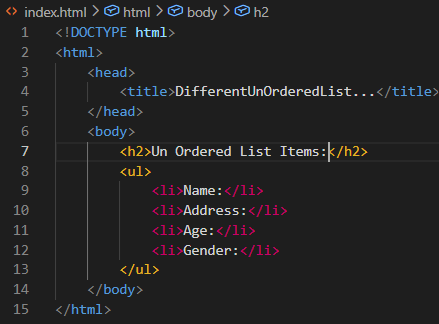
            </td>
          </tr>
        </table>
        
        - 
14.1.1.2.1.4)**type="none": Then The Type Of The Ordering Is None...

        <table>
          <tr>
            <td>
              
            </td>
            <td>
              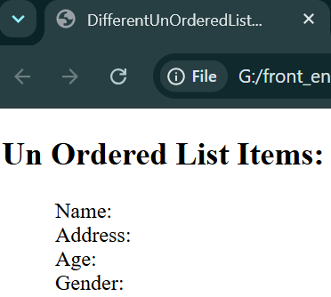
            </td>
          </tr>
        </table>
        
  - 
14.1.2)**&lt;OL&gt;: It Is A Nested HTML Tag , It Is Mainly Used To Make An Ordered List Of Different Items In Your Own HTML Document (Own Web Page)...&lt;/OL&gt;

  
    - 
14.1.2.1)**&lt;LI&gt;: It Is A Nested HTML Tag , It Is Mainly Used To Add Different List Items Inside The Ordered List In Your Own HTML Document (Own Web Page)...

    <table align="center">
      <tr>
        <td>
          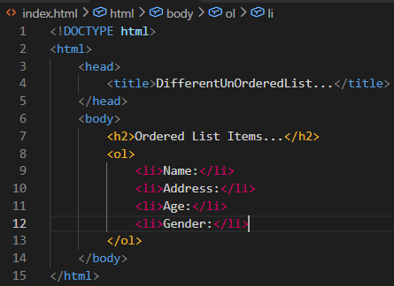
        </td>
        <td>
          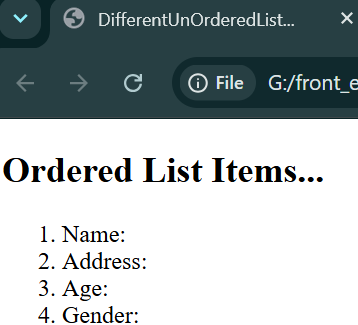
        </td>
      </tr>
    </table>

  - 
<strong>14.1.2.2)**There Are Some Different HTML Attributes That You Can Use Inside &lt;OL&gt; HTML Tag Like:</strong>

  
    - 
14.1.2.2.1)**Reversed: It Is An Element HTML Attribute , It Is Mainly Used Inside Your &lt;OL&gt; To Reverse The Ordering Of Different Items In The Ordered List In Your Own HTML Document (Own Web Page)...

    <table align="center">
      <tr>
        <td>
          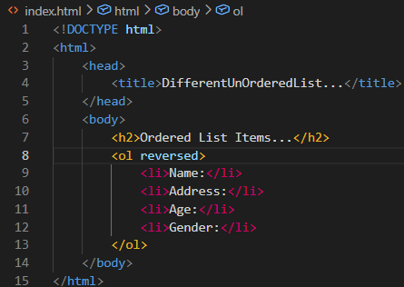
        </td>
        <td>
          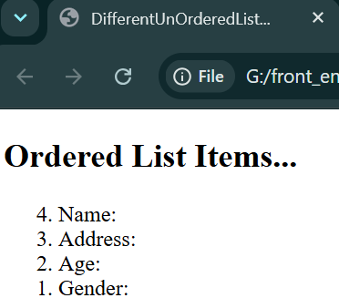
        </td>
      </tr>
    </table>

    - 
14.1.2.2.2)**Type: It Is An Element HTML Attribute , It Is Mainly Used To Define The Type Of The Ordering Of Different List Items Of The Ordered List In Your Own HTML Document (Own Web Page)... , And   <strong>There Are Different Values Of The Type Of The Ordered List Items Like: </strong>

      - 
14.1.2.2.2.1)**Type="A": It Is Mainly Used To Make The Ordering Of Different List Items As A Capital (UpperCase) English Alphabetic...

      <table align="center">
        <tr>
          <td>
            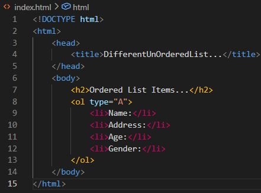
          </td>
          <td>
            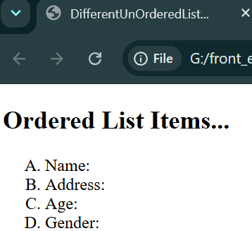
          </td>
        </tr>
      </table>

      - 
14.1.2.2.2.2)**Type="a": It Is Mainly Used To Make The Ordering Of Different List Items As a Small (LowerCase) English Characters...

    <table align="center">
      <tr>
        <td>
          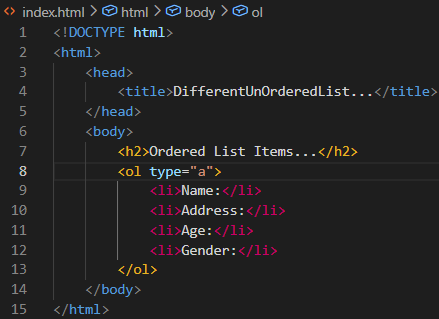
        </td>
        <td>
          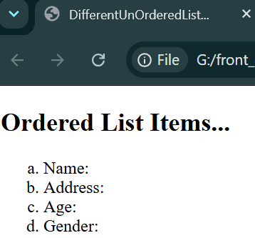
        </td>
      </tr>
    </table>
      - 
14.1.2.2.2.3)**Type="I": It Is Mainly Used To Make The Ordering Of Different List Items As A Capital (UpperCase) Romanic Characters...

  <table>
    <tr>
      <td>
        
      </td>
      <td>
        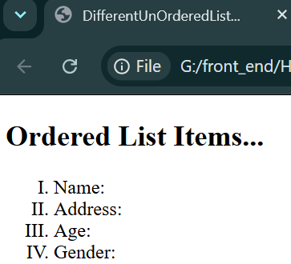
      </td>
    </tr>
  </table>
      - 
14.1.2.2.2.4)**Type="i": It Is Mainly Used To Make The Ordering Of Different List Items As A Small (LowerCase) Characters...

  <table>
    <tr>
      <td>
        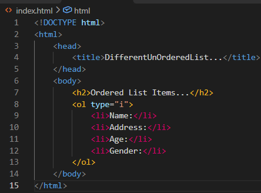
      </td>
      <td>
        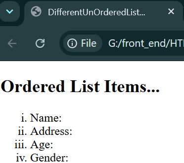
      </td>
    </tr>
  </table>
      - 
14.1.2.2.2.5)**Type="1": It Is Mainly Used To Make The Ordering Of Different List Items As A Numeric Characters , It Is The Default Type Of The Ordering Of The Ordered List Of Different Items...

  <table align="center">
    <tr>
      <td>
        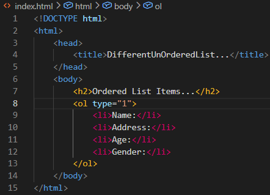
      </td>
      <td>
        
      </td>
    </tr>
  </table>

  
