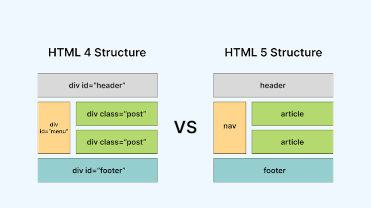
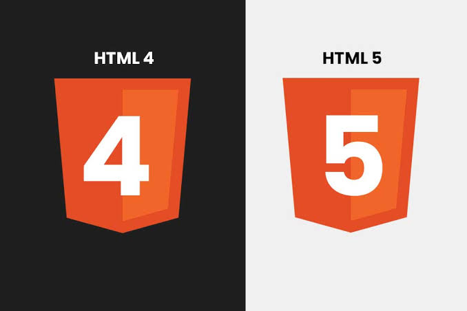

# 01)**Introduction To The HTML Language:

01.1)**HTML: It Refers To The Hyper Text Markup Language...

01.2)**HTML: It Is The Main , And Frist Language To Build The Structure Of Your Own HTML Document...

01.3)**HTML: It Is Standard Language Like Java Script (JS) Language , Because You Can Not Replace The HTML Language With Any Language To Build The Structure Of Your Own HTML Document...

01.4)**HTML: It Is Not A Programming Language , But It Is A Markup Language...

01.5)**HTML: It Has More Than One Versions Like HTML V3 , HTML V4 , And Finally HTML V5...

<table width="50%" align="center">
  <tr>
    <td></td>
  </tr>
  <tr>
    
  </tr>
</table>
