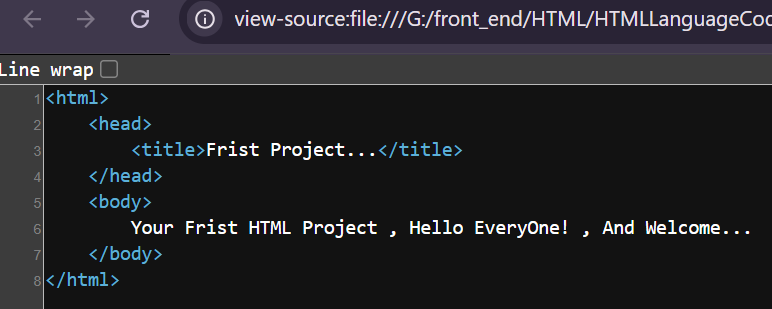
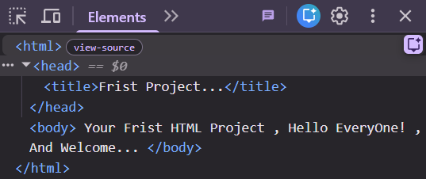
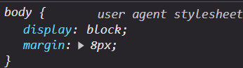

# 02)**HTML Elements , And Browsers:

02.1)**View Page Source: Control (CTRL) + "U" : It Is Mainly Used To Get All Source Codes Of Your Own HTML Document (Own Web Page...

  

02.2)**Inspect: Control (CTRL) + Shift + "I" : It Is Used As A Developer Tool To Know The Type Of Different HTML Elements That Mainly Used To Build Your Own HTML Document (Own Web Page)...

  

02.3)**UA Stylesheet: It Refers To The User Agent Stylesheet , It Is The CSS Custom Styling , Or The CSS Custom Decorations That Gives From Different Browsers Like Google Chrome , Firefox Developer Edition , Or ETC For Different HTML Tags From The HTML Tag To Distinguish , And Appearence Between Different HTML Tags From The HTML Language...

  

02.4)**SEO: It Refers To The Search Engines Optimization , It Is The Process Of Optimizing Different Search Engines Results Pages (SERPs) , It Makes Your Own HTML Document (Own Web Page) Appears In The Frist Searching Result In Different Browsers Like Google Chrome , Firefox Developer Edition , Or ETC...

<table>
  <tr>
    <td>
      
    </td>
    <td>
      
    </td>
  </tr>
</table>
