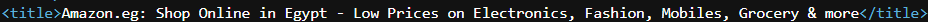
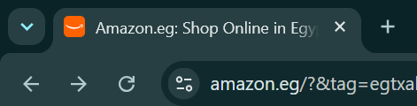
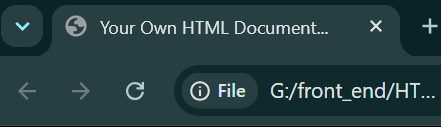
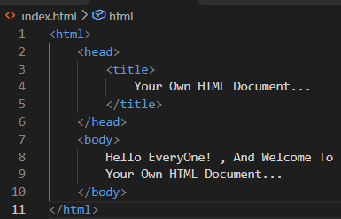
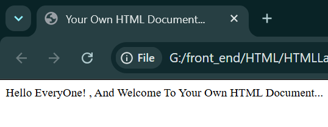

# 03)**Your Frist Project , And Frist HTML Document:

### 03.1)**There Are Different Ways Of Formatting , Or Styling Your HTML Codes Like:

  - 
03.1.1)**Tab: It Is Mainly Used To Make A One Step Forward In Your Own HTML Document (Own Web Page)...

  - 
03.1.2)**Shift Tab: It Is Mainly Used To Make A One Step Backward In Your Own HTML Document (Own Web Page)...

  - 
03.1.3)**Alt Shift Arrow Up: It Is Mainly Used To Take A Copy Of Any HTML Line Code In The Top...

  - 
03.1.4)**Alt Shift Arrow Down: It Is Mainly Used To Take A Copy Of Any HTML Line Code In The Bottom...

-------------------------------------------------------------------------------------

> [!important]
> 
Using Different HTML Styling , Or Formatting Ways To Write A Clean , Styling , And Formatting HTML Codes To Make Different Users , Or Developers Easy To Read , And Understand Different HTML Codes Of Your Own HTML Document (Own Web Page)...

--------------------------------------------------------------------------------------

03.2)**The Frist HTML Document File , Or The Main HTML Document File In Any Project Must Name With Index With Any Extension , Because When Uploading Your Own Project In Any Servers , Different Browsers Like Google Chrome ,  Firefox Developer Edition , At The Frist Is Searching For index File To Start Archiving , Or Rendering Your Own HTML Document (Own Web Page) From This Point , Because It Is The Entry Point Or Starting Point From Any Server For Different Browsers...

--------------------------------------------------------------------------------------

03.3)**Different HTML Elements From The HTML Language Are Called HTML Tags...

--------------------------------------------------------------------------------------

> [!important]
> The Default Direction Of Your Own HTML Document (Own Web Page) Is From Left Direction To Right Direction...
>   
> The Default Language Of Your Own HTML Document (Own Web Page) is The English Language...

--------------------------------------------------------------------------------------

### 03.4)**There Is A Structure To Build Your Own HTML Document (Own Web Page):
  - 
&lt;HTML&gt;: It Is A Nested HTML Tag , It Refers To Hyper Text Markup Language , It Is The Root Of Your Own HTML Document (Own Web Page) , It Contains All HTML Codes Of Your Own HTML Document (Own Web Page) , And Finally &lt;HTML&gt; Contains Two Important HTML Tags Like &lt;HEAD&gt; , And &lt;BODY&gt; HTML Tags...&lt;/HTML&gt;

  - 
&ltHEAD&gt;: It Is A Nested HTML Tag , It Refers To Head Of Your Own HTML Document (Own Web Page) , It Represents A Collection Of MetaData For Your Own HTML Document (Own Web Page) To Know Different Browsers Like Google Chrome , Firefox Developer Edition , Or ETC How To Archive , Or Render Your Own HTML Document (Own Web Page) , &lt;HEAD&gt; Must Use Inside &lt;HTML&gt;...&lt;/HEAD&gt;

  
    - 
MetaData: Refers To Collection Of Instructions Or Information About Information For Different Browsers Like Google Chrome , Firefox Developer Edition , Or ETC How To Archive , Or Render Your Own HTML Document (Own Web Page)...

    
  - 
&lt;BODY&gt;: It Is A Nested HTML Tag , It Refers To Body Of Your Own HTML Document (Own Web Page) , It Refers To The Content Of Your Own HTML Document (Own Web Page) For Different Users Of Your Own HTML Document (Own Web Page) , You Must Use &lt;BODY&gt; HTML Tag Inside &lt;HTML&gt; Tag &lt;/BODY&gt;

  
  - 
&lt;TITLE&gt;: It Is A Nested HTML Tag , It Refers To The Title Of Your Own HTML Document (Own Web Page) , It Does Not Appear For Different Users In Your Own HTML Document (Own Web Page) , It Appears In The Searching Result As A Title Of Your Own HTML Document (Own Web Page) , It Appears In The Searching Tab In The Left Top In Different Browsers Like Google Chrome , Firefox Developer Edition , Or ETC , You Must Use &lt;TITLE&gt; HTML Tag Inside &lt;HEAD&gt; HTML Tag Inside &lt;HTML&gt; In Your Own HTML Document (Own Web Page)...&lt;/TITLE&gt;

---------------------------------------------------------------------------------------------------

<table>
  <tr>
    <td colspan="2">
      
    </td>
  </tr>
  <tr>
    <td>
      
    </td>
    <td>
      
    </td>
  </tr>
  <tr>
    <td colspan="2">
      
    </td>
  </tr>
</table>

-----------------------------------------------------------------------------------

<table>
  <tr>
    <td>
      
    </td>
    <td>
      
    </td>
  </tr>
</table>

--------------------------------------------------------------------------------------

>[!Tip]
> 
Using Title In Your Own HTML Document File Makes Your Own HTML Document (Own Web Page) Appears In The Frist Searching Results In Different Browsers Like Google Chrome , Firefox Developer Edition , Or ETC...

----------------------------------------------------------------------------------------

> [!Important]
> 
Body Is The Visible Part Of Your Own HTML Document (Own Web Page) That Contains Different Contents That Appears For Different Users Of Your Own HTML Document (Own Web Page)...

