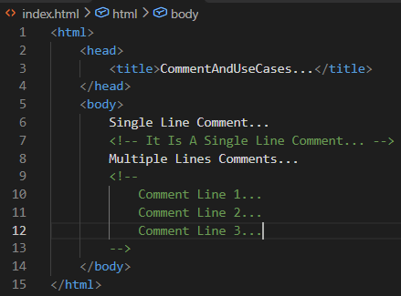
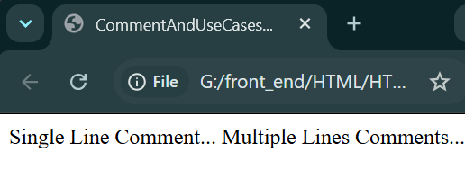
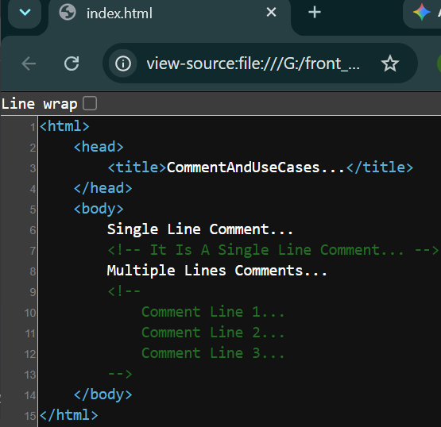

# 05)**HTML Comments , And Use Cases:

### 05.1)**There Are Different Types Of The HTML Comments:

  - 05.1.1)**&lt;!--Single Line Comment...--&gt;: Control (CTRL) + "ظ": It Is Mainly Used To Make A Single Line Comment In Your Own HTML Document (Own Web Page)...

----------------------------------------------------------------------------------------------

  - 05.1.2)**
Multiple Lines Comments...
    &lt;!--
      Comment Line 1.
      Comment Line 2.
      Comment Line 3.
     --&gt; : It Is Mainly Used To Make A Multiple Lines Comments In Your Own HTML Document (Own Web Page)...
  

--------------------------------------------------------------------------------------------------------

> [!Important]
> 
Different Contents Inside Different HTML Comments Does Not Appear For Different Users Of Your Own HTML Document (Own Web Page)...

----------------------------------------------------------------------------------------------------------

> [!Tip]
> 
The Main Purpose Of Using Different HTML Comments In Your Own HTML Document (Own Web Page) Is Used As A Tool Tip For Different Users , Or Developers Of Your Own HTML Document (Own Web Page) , Why Use This Line Of The HTML Code In Your Own HTML Document (Own Web Page) By Different Developers...

------------------------------------------------------------------------------------------------------------

<table align="center">
  <tr>
    <td>
      
    </td>
  </tr>
  <tr>
    <td>
      
    </td>
  </tr>
  <tr>
    <td>
      
    </td>
  </tr>
</table>
