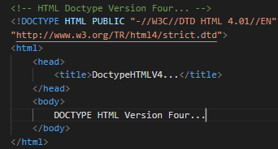
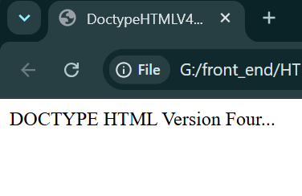
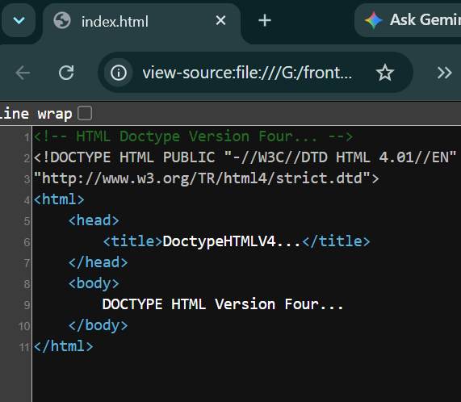
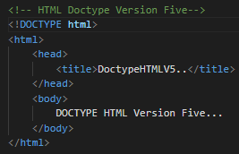
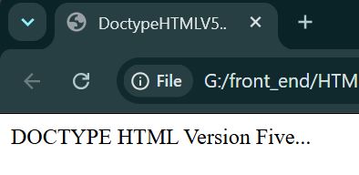
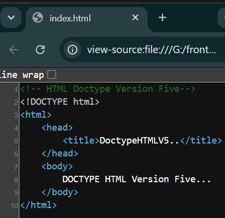

# 06)**Doctype HTML:

- 
 06.1)**DOCTYPE: It Is A Collection Of Instructions For Different Browsers Like Google Chrome , Firefox Developer Edition , Or ETC How To Archive , Or Render Your Own HTML Document (Own Web Page) , It Is Not A Content That Appears For Different Users Of Your Own HTML Document (Own Web Page)...

  - <strong align="justify">06.2)**There Are Different Types Of The DOCTYPE In The HTML Language Like:</strong>

    - <strong align="justify">06.2.1)**The Doctype Of The HTML Version 4 (HTMLV4) Is: &lt;!DOCTYPE HTML PUBLIC &quot;-//W3C//DTD HTML 4.01//EN&quot;
&quot;http://www.w3.org/TR/html4/strict.dtd&quot;&gt;</strong>

------------------------------------------------------------------

  <table align="center">
    <tr>
            <td>
        
      </td>
      <td>
        
      </td>
    </tr>
    <tr>
      <td>
        
      </td>
    </tr>
  </table>
    - <strong align="justify">06.2.2)**The Doctype Of The HTML Version 5 (HTMLV5) Is: &lt;!DOCTYPE html&gt;</Strong>
  
-------------------------------------------------------------------------------------------
  <table align="center">
    <tr>
      <td>
        
      </td>
      <td>
        
      </td>
      <td>
        
      </td>
    </tr>
  </table>
  
  ---------------------------------------------------------------------------------------------
  
  > [!important]
  > 
DOCTYPE HTML Is Not A Case Sensitive , This Means Different HTML Doctypes , Or Different HTML Tags Do Not Affect By Using Small Letters , Or Capital Letters...

  -----------------------------------------------------------------------------------------------

  > [!Tip]
  > 
Different HTML Doctype Does Not Appear For Different Users In Your Own Web Page (Own HTML Document) But It Appears When Opening The View Page Source Of Your Own HTML Document (Own Web Page)...

  ------------------------------------------------------------------------------------------------
