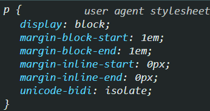
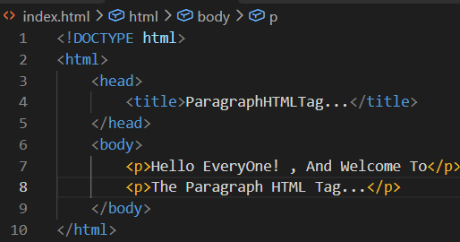
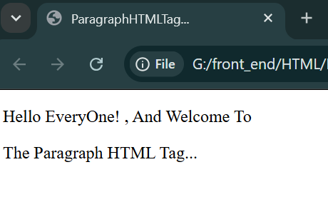

# 07)**Paragraph HTML Tag:

<strong align="justify">  - 07.1)**&lt;P&gt;: It Is A Nested HTML Tag , It Refers To A Paragraph In Your Own HTML Document (Own Web Page) , It Is Mainly Used To Add Different Paragraphs In Your Own HTML Document (Own Web Page)...&lt;/P&gt;</strong>

----------------------------------------------------------------------------------------------------

<strong align="justify">  - 07.2)**&lt;P&gt; HTML Tag , It Is Used If You Have A Text , And You Want To Add In Your Own HTML Document (Own Web Page)...&lt;/P&gt;</strong>

-----------------------------------------------------------------------------------------------------

<strong align="justify">  - 07.3)**&lt;P&gt; HTML Tag , It Has A CSS Custom Decoration (CSS Custom Styling) From The User Agent Stylesheet (UA Stylesheet) From Different Browsers Like Google Chrome , Firefox Developer Edition , Or ETC&lt;/P&gt;</strong>

  

------------------------------------------------------------------------------------------------------

<table>
  <tr>
    <td>
      
    </td>
    <td>
      
    </td>
  </tr>
</table>
