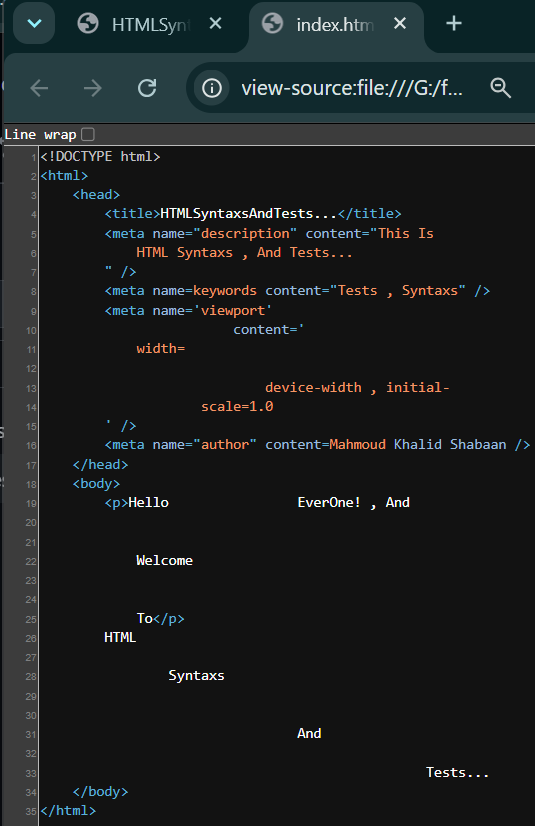
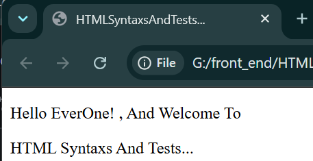

# 08)**HTML Syntax , And Tests:

08.1)**Different Values Of Different HTML Attributes In Your Own HTML Document (Own Web Page) Must Be Inside Double Quotations (&quot;) , Or Single Quotation (&apos;) If The Value Of Any HTML Attribute Is More Than One Words...

--------------------------------------------------------------------------------------------

08.2)**Different Values Of Different HTML Attributes In Your Own HTML Document (Own Web Page) If The Value Of Any HTML Attribute Is More Than One Words , Then Different Browsers Like Google Chrome , Firefox Developer Edition , Or ETC Takes Others Words Else The Frist Word As A New HTML Attribute , And Also Takes The Frist Word As A Value Of The HTML Attribute...

--------------------------------------------------------------------------------------------

08.3)**Different Browsers Like Google Chrome , Firefox Developer Edition , Or ETC Agnors Different Spaces In Your Own HTML Document (Own Web Page) , Because Different Browsers Like Google Chrome , Firefox Developer Edition , Or ETC Do Not Know Any Distance , And Area Of Different Spaces....

--------------------------------------------------------------------------------------------

<table align="center">
  <tr>
    <td></td>
        <td>
      
    </td>
    <td>
                      
    </td>
  </tr>
</table>
